  

## 👨🏻‍💻 &nbsp;About Me

I care a lot about scale — not just of systems, but of teams. Helping people grow is honestly the part of the job I enjoy most.

I studied Computer Engineering at three universities in three different countries, and dropped out of all three. Make of that what you will — I like to think the classroom was just never where I learned best.

Most of my real education has come from building things and reading way too much about mobile architecture and UI/UX along the way. I'm deeply invested in the open-source community, regularly contributing to projects that shape the mobile and Dart ecosystem.

Lately I've been steering toward **AI engineering**: I contribute to [Genkit](https://github.com/genkit-ai/genkit), Google's open-source framework for building agentic apps, and I want to spend more of my time building AI-powered products. I'm comfortable on the backend and web too, with **NestJS** and **Next.js**.

Outside of work: I freelance, I'm a father (to one of each), and I paint/draw whenever I get the chance.

## 🧠 &nbsp;What I Focus On
- 🏗️ &nbsp; Designing mobile systems that hold up as teams and codebases grow — built for where the product is heading, not just where it is today.
- 🎥 &nbsp; Years spent in Video on Demand, obsessing over the small details that make streaming actually feel smooth.
- 🛠 &nbsp; Flutter and SwiftUI are my daily tools, whichever the project calls for.
- ⚙️ &nbsp; A firm believer in SOLID principles — not as dogma, but because untangling bad architecture later is nobody's idea of fun.
- 🤖 &nbsp; AI-powered products: model-provider plugins, tool calling, and agent/session plumbing in Genkit, and bringing that to mobile and web apps.
- 🧩 &nbsp; Full-stack when the product needs it: NestJS APIs and Next.js front ends alongside the mobile apps.
- 🧑‍🤝‍🧑 &nbsp; Leading mobile teams, mostly by trying to be the mentor I wish I'd had earlier on.
- 🌐 &nbsp; Contributing to open-source ecosystems that I believe in — shipping fixes and features that benefit the community.

## 🌐 &nbsp;Open Source

<!-- OSS-BADGES:START -->

  
  
  
  
  
  

<!-- OSS-BADGES:END -->

**AI: [Genkit](https://github.com/genkit-ai/genkit)** — I work on model-provider plugins and the agent/session layer, across the JS, Python and Go SDKs:

- **Model plugin:** send back empty signed thinking blocks ([#6838](https://github.com/genkit-ai/genkit/pull/6838), merged)
- **OpenAI-compatible plugin:** keep assistant text alongside tool calls ([#6792](https://github.com/genkit-ai/genkit/pull/6792), merged)
- In review: `deleteSession` for agents in [JS](https://github.com/genkit-ai/genkit/pull/6857) and [Go](https://github.com/genkit-ai/genkit/pull/6858), routing provider betas to the beta API ([#6800](https://github.com/genkit-ai/genkit/pull/6800)), and function tools for Antigravity ([#6802](https://github.com/genkit-ai/genkit/pull/6802))

**Mobile: [Firefox iOS](https://github.com/mozilla-mobile/firefox-ios)** — crash fixes, Redux state architecture, and paying down technical debt in the tab and bookmarks layers:

- **[Logins] Fix crash from concurrent `addLogin`/`updateLogin`/`verifyLogins` calls** ([#34973](https://github.com/mozilla-mobile/firefox-ios/pull/34973))
- **[Redux] Adopt the `@Copyable` macro** across `TabTrayState`, `RemoteTabsPanelState`, and `TabPeekState` ([#34838](https://github.com/mozilla-mobile/firefox-ios/pull/34838), [#34762](https://github.com/mozilla-mobile/firefox-ios/pull/34762), [#34744](https://github.com/mozilla-mobile/firefox-ios/pull/34744))
- **[Tab Tray] Explicitly unsubscribe from the Redux store on teardown** ([#35123](https://github.com/mozilla-mobile/firefox-ios/pull/35123))
- **Reader mode navigation moved onto `NavigationBrowserAction`** ([#35319](https://github.com/mozilla-mobile/firefox-ios/pull/35319))

**Dart & Flutter:** in [`dart-lang/tools`](https://github.com/dart-lang/tools) I've landed multiple superclass constraints and cascade helpers for `code_builder`, setext heading precedence and nested-list fixes in `markdown`, `strictProtocolChecks` for `json_rpc_2`, and `PathDependency` constraints in `pubspec_parse`. I also cut memory use when saving Performance data in [Flutter DevTools](https://github.com/flutter/devtools) ([#10034](https://github.com/flutter/devtools/pull/10034)), with more in review across the toolchain and the [Dart SDK](https://github.com/dart-lang/sdk) analysis server.

I've also sent fixes to [Flutter](https://github.com/flutter/flutter) (widgets and tooling), [AppFlowy](https://github.com/AppFlowy-IO/AppFlowy), and [`sentry-dart`](https://github.com/getsentry/sentry-dart), most still in review.

Earlier on Apple platforms: fixes in [**IINA**](https://github.com/iina/iina) (PiP sizing on full-screen transitions), [**CodeEdit**](https://github.com/CodeEditApp/CodeEdit), and Brave iOS.

→ &nbsp;Browse everything I've [**opened**](https://github.com/search?q=author%3Ahkarmoush+is%3Apr&type=pullrequests) or had [**merged**](https://github.com/search?q=author%3Ahkarmoush+is%3Apr+is%3Amerged&type=pullrequests) across public repos.

## 🛠 &nbsp;Tech Stack

- 📱 &nbsp;Mobile
  
  
  
  
- 🌐 &nbsp;Backend & Web
  
  
  
- 🤖 &nbsp;AI
  
  
- 💻 &nbsp;Languages
  
  
- ⚙️ &nbsp;DevOps & CI
  
  
  
  

## ☕ &nbsp;Support Me
If any of my work has been useful to you, consider supporting it:
  

    
  

You can also use the **Sponsor** button at the top of this repo, or check [CONTRIBUTING.md](./CONTRIBUTING.md) for other ways to support and connect.

## 📊 &nbsp;GitHub Stats

  

  <picture>
    <source media="(prefers-color-scheme: dark)" srcset="https://raw.githubusercontent.com/hkarmoush/hkarmoush/output/github-contribution-grid-snake-dark.svg" />
    <source media="(prefers-color-scheme: light)" srcset="https://raw.githubusercontent.com/hkarmoush/hkarmoush/output/github-contribution-grid-snake.svg" />
    
  </picture>

  You have finally discovered my Github profile.  
  Please feel free to clone/fork projects, raise issues and submit PRs if you think something could be better.  
  Ask me anything <a href="https://github.com/hkarmoush/hkarmoush/issues/new"><b>I guarantee a great conversation</b></a> 
  or <a href="mailto:hkarmoush@gmail.com"><b>get in touch</b></a>

